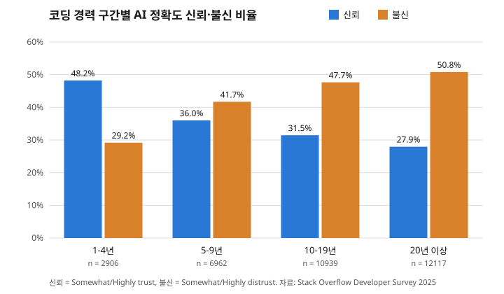

# 과제 10 — 4단계: 결과 해석, 결론과 한계

> 작성일: 2026-11-13 · 가설: **개발자는 코딩 경력(연수)이 길수록 AI 도구 출력의 정확도를 신뢰하는 정도가 낮다.**
> 판정 기준은 [01-hypothesis.md](01-hypothesis.md), 설계는 [03-design.md](03-design.md)에서 본 분석 전에 정한 그대로입니다.
> 숫자의 출처: `results/summary.txt`(본 분석), `results/table_by_experience.csv`(구간별 응답 수), `results/exploratory.txt`(탐색 분석).

---

## 1. 결과 정리 (T10-C31)

### 표 1. 주 분석 — 판정에 쓰는 유일한 분석

| 항목 | 값 |
|---|---|
| 전체 응답자 | 49,191명 |
| 분석 대상(두 문항 모두 응답) | 32,924명 (제외 16,267명: `YearsCode` 빈값 6,149건, `AIAcc` 빈값 15,894건, 중복 포함) |
| 스피어만 순위상관 ρ (`YearsCode` × `AIAcc`) | **−0.1336** |
| 근사 95% 구간 | −0.1442 ~ −0.1229 |
| 한쪽 p 값 | 2.23 × 10⁻¹³² |

### 표 2. 코딩 경력 구간별 응답 수와 비율 (보조 분석)

| 코딩 경력 | 응답자 | Highly distrust | Somewhat distrust | Neither | Somewhat trust | Highly trust | 신뢰 비율 | 불신 비율 | 평균 점수 |
|---|---|---|---|---|---|---|---|---|---|
| 1–4년 | 2,906 | 266 | 582 | 657 | 1,181 | 220 | 48.2% | 29.2% | 3.174 |
| 5–9년 | 6,962 | 1,179 | 1,724 | 1,552 | 2,289 | 218 | 36.0% | 41.7% | 2.805 |
| 10–19년 | 10,939 | 2,274 | 2,940 | 2,283 | 3,141 | 301 | 31.5% | 47.7% | 2.658 |
| 20년 이상 | 12,117 | 2,771 | 3,385 | 2,575 | 3,130 | 256 | 27.9% | 50.8% | 2.564 |

네 구간의 응답자 합은 32,924명으로 분석 대상과 같습니다.

### 그림 1. 코딩 경력 구간별 신뢰·불신 비율

### 표 3. 그 밖의 분석 (판정에 쓰지 않음)

| 분석 | 종류 | n | ρ | 근사 95% 구간 |
|---|---|---|---|---|
| 직업 경력 `WorkExp` × 신뢰 | 보조(사전 계획) | 30,780 | −0.0334 | −0.0446 ~ −0.0223 |
| 코딩 경력 × AI 호감도 `AISent` | 보조(사전 계획) | 32,337 | −0.0614 | −0.0723 ~ −0.0506 |
| 코딩 경력 50년 이하만 | 민감도(예비 실행 뒤 추가) | 32,741 | −0.1331 | −0.1437 ~ −0.1225 |
| AI 도구를 쓰는 응답자만 | 민감도(예비 실행 뒤 추가) | 25,852 | −0.1046 | −0.1166 ~ −0.0925 |

---

## 2. 가설과 일치하는 결과, 일치하지 않는 결과 (T10-C32, C35)

**일치하는 결과**

1. 주 분석의 ρ = −0.1336 은 음수이고, 미리 정한 크기(−0.05)보다 더 아래입니다.
2. 경력 구간이 올라갈수록 신뢰 비율이 48.2% → 36.0% → 31.5% → 27.9% 로 한 번도 오르지 않고 내려갔습니다. 불신 비율은 29.2% → 41.7% → 47.7% → 50.8% 로 올라갔습니다.
3. 있기 어려운 경력 값(50년 초과)을 빼도(ρ = −0.1331), AI 도구 사용자만 보아도(ρ = −0.1046) 방향과 기준 충족 여부가 같았습니다.
4. AI 호감도로 바꿔 보아도 ρ = −0.0614 로 방향이 같았습니다.

**일치하지 않거나 가설에 불리한 결과**

1. **직업 경력(`WorkExp`)으로 보면 ρ = −0.0334 로, 미리 정한 크기(−0.05)에 못 미칩니다.** 방향은 같지만 "경력"을 직업 경력으로 정의했다면 이 연구의 기준으로는 지지되지 않았을 결과입니다.
2. **관계의 크기가 작습니다.** ρ = −0.1336 은 순위 변동의 약 2%(ρ² ≈ 0.018)만 설명하는 수준입니다. 경력 20년 이상에서도 27.9%(3,386명)는 AI를 신뢰한다고 답했고, 1–4년에서도 29.2%(848명)는 불신한다고 답했습니다. 경력만으로 한 사람의 신뢰를 짐작할 수는 없습니다.
3. **차이의 대부분이 초반에 몰려 있습니다.** 신뢰 비율은 1–4년과 5–9년 사이에서 12.2%p 떨어졌고, 그 뒤 두 구간에서는 4.5%p, 3.6%p 떨어졌습니다. "경력이 길수록 계속 낮아진다"기보다 "처음 몇 해가 지나면 낮아지고 그 뒤로는 완만하다"에 가깝습니다.
4. AI 도구 사용자만 보면 관계가 조금 약해집니다(−0.1336 → −0.1046).

---

## 3. 판단과 근거 (T10-C33, C34)

**판단: 미리 정한 기준에 따라 가설은 2025년 자료에서 지지되었다. 다만 관계는 약하고, 직업 경력으로는 기준에 미치지 못했으며, 문항이 다른 2026년 자료에서는 재현되지 않았다(5절).**

| 판정 기준 (1단계에서 정함) | 원자료에서 나온 값 | 충족 |
|---|---|---|
| ρ ≤ −0.05 | ρ = −0.1336 (n = 32,924) | 예 |
| 한쪽 p < 0.05 | p = 2.23 × 10⁻¹³² | 예 |
| 반증 조건 ρ ≥ 0 | 근사 95% 구간의 위쪽 끝이 −0.1229 | 해당 없음 |

판단을 뒷받침하는 원자료 값은 표 2의 응답 수입니다. 예를 들어 1–4년 구간 2,906명 가운데 신뢰 응답은 1,181 + 220 = 1,401명(48.2%)이고, 20년 이상 구간 12,117명 가운데 신뢰 응답은 3,130 + 256 = 3,386명(27.9%)입니다.

---

## 4. 불일치 원인 후보 검토 (T10-C36) — 탐색적 결과

코딩 경력(ρ = −0.134)과 직업 경력(ρ = −0.033)의 결과가 왜 다른지, 원인 후보 네 가지를 적고 데이터로 대조할 수 있는 것부터 확인했습니다.

> **이 절의 계산은 본 분석 결과를 본 뒤에 추가한 탐색 분석입니다.** 목적과 방법은 실행 전에 `scripts/explore.py` 첫머리에 적었고, 결과는 `results/exploratory.txt` 에 있습니다. 가설 판정에는 쓰지 않습니다.

| 후보 | 대조 방법 | 결과 | 판단 |
|---|---|---|---|
| **E1. 표본이 다르다** — 직업 경력이 0이면 `WorkExp` 를 비우게 되어 있어 배우는 사람이 빠진다 | 세 문항에 모두 답한 같은 30,632명으로 두 상관을 다시 계산 | 같은 사람들인데도 코딩 경력 ρ = −0.1400, 직업 경력 ρ = −0.0330 | **원인이 아님.** 표본을 맞춰도 차이가 그대로다. |
| **E2. 관계가 초반 몇 해에 몰려 있다** | 코딩 경력 5년 이상, 10년 이상만으로 상관 계산 | 5년 이상 ρ = −0.0863 (n = 30,018), 10년 이상 ρ = −0.0509 (n = 23,056) | **일부 설명.** 초보 구간을 빼면 관계가 약해진다. |
| **E3. 응답자 유형이 다르다** — 배우는 사람이 섞여서 생긴 관계다 | `MainBranch` 별 신뢰 비율, 직업 개발자만의 상관 | 배우는 사람(1,215명)의 신뢰 비율은 45.3%로 직업 개발자(25,560명) 32.3%보다 높다. 그러나 직업 개발자만으로도 ρ = −0.1268 | **원인이 아님.** 직업 개발자 안에서도 관계가 거의 같다. |
| **E4. 나이와 겹친다** — 경력이 길면 나이도 많다 | 나이대별 신뢰 비율, 같은 나이대 안에서의 상관 | 나이대별 신뢰 비율은 31.7%(18–24세), 33.7%, 33.0%, 32.3%, 31.1%, 28.4%(65세 이상)로 거의 같다. 같은 나이대 안에서는 ρ 가 −0.176 ~ −0.313 으로 전체보다 오히려 컸다 | **원인이 아님.** 신뢰는 나이에 따라 거의 달라지지 않았고, 같은 나이 안에서 코딩을 오래 한 사람일수록 신뢰가 낮았다. |

**직업 경력 구간별 신뢰 비율**(세 문항 모두 응답 30,632명): 1–4년 34.2%, 5–9년 33.2%, 10–19년 33.1%, 20년 이상 30.6%. 코딩 경력 구간(48.2% → 27.9%)과 달리 거의 평평합니다.

**탐색에서 보인 것(검증된 것이 아님)**

- 신뢰는 **나이**나 **직장 연차**에 따라서는 거의 달라지지 않고, **코딩을 해 온 기간**에 따라 달라졌습니다. 직업 경력은 나이와 함께 움직이는 값이라 관계가 약하게 나온 것으로 보입니다.
- 관계는 코딩을 시작한 지 몇 해 안 된 사람과 그 밖의 사람 사이에서 가장 뚜렷했습니다.

---

## 5. 가설을 고쳤는가 (T10-C37)

**가설과 판정 기준은 고치지 않았습니다.** 1단계에 적은 문장과 기준 그대로 판정했습니다.

탐색 분석에서 다음과 같은 후속 가설이 떠올랐지만, 이것은 **결과를 본 뒤에 만든 탐색적 가설**이며 같은 자료로 검증된 것처럼 쓰지 않습니다.

- 탐색적 가설: "AI 정확도에 대한 신뢰는 나이나 직장 연차가 아니라 코딩을 시작한 뒤 지난 기간과 관련이 있으며, 차이는 처음 5년 안에 가장 크다."
- 이것을 검증하려면 **새 자료**가 필요하므로, 2026년 설문 자료로 예측 네 가지를 미리 적어 두고 다시 계산했습니다. 계획·결과는 [05-replication.md](05-replication.md)에 있습니다.
- **결과: 2026년 자료에서는 재현되지 않았습니다.** 2026년의 신뢰 문항(`AITrust`, 2025년과 문구·보기가 다름)으로는 코딩 경력과 신뢰의 순위상관이 ρ = +0.0137 (n = 7,158)로 음의 관계가 없었고, 탐색적 가설의 예측 가운데 "직업 경력의 관계가 더 약하다"도 틀렸습니다(ρ = +0.0727 대 +0.0101). 따라서 탐색적 가설은 지지되지 않은 것으로 적습니다.

---

## 6. 결론 (T10-C38)

스택오버플로 개발자 설문 2025 에서 코딩 경력과 AI 정확도 신뢰에 모두 답한 32,924명을 분석한 결과, 코딩 경력이 긴 응답자일수록 AI 도구 출력의 정확도를 신뢰하는 점수가 낮은 경향이 있었다(스피어만 ρ = −0.1336, 한쪽 p = 2.23 × 10⁻¹³²). 이 값은 자료를 열기 전에 정한 지지 기준(ρ ≤ −0.05, p < 0.05)을 충족하므로 가설은 지지되었다. 신뢰한다고 답한 비율은 코딩 경력 1–4년에서 48.2%, 20년 이상에서 27.9%였다.

그러나 이 관계는 약하다. 경력은 신뢰 순위 변동의 약 2%만 설명했고, 차이의 대부분은 경력 1–4년과 5–9년 사이에서 나타났다. 또 경력을 직업 경력으로 재면 ρ = −0.0334 로 미리 정한 크기에 미치지 못했다. 따라서 이 자료가 뒷받침하는 결론은 "경력이 길면 AI를 믿지 않는다"가 아니라, "이 설문의 응답자 가운데 코딩을 시작한 지 얼마 안 된 사람이 그 밖의 사람보다 AI 출력의 정확도를 더 신뢰하는 경향이 있었다"까지이다.

더 중요한 제한은 이 결과가 새 자료에서 재현되지 않았다는 점이다. 2026년 설문에서 신뢰를 묻는 문항(어떤 일까지 AI를 믿고 맡기는지를 묻는 문항으로, 2025년과 문구와 보기가 다르다)으로 같은 계산을 미리 정해 두고 다시 했을 때, 코딩 경력과 신뢰의 순위상관은 ρ = +0.0137 (n = 7,158)로 음의 관계가 나타나지 않았다. 문항과 응답자가 달라서 재현되지 않은 이유를 가를 수는 없지만, 2025년에 본 관계가 설문 문항이나 시기에 따라 달라지는 약한 관계일 가능성을 배제할 수 없다. 두 해에서 공통으로 남은 것은 코딩 경력 1–4년 구간의 신뢰 비율이 다른 구간보다 높았다는 점뿐이다(2025년 48.2%, 2026년 26.6%. 두 값은 문항이 달라 서로 견줄 수 없다).

나에게 주는 의미는 이렇다. 나는 코딩 경력이 짧은 쪽에 속하고, 두 해의 자료 모두에서 그 집단은 AI의 결과를 신뢰한다고 답한 비율이 가장 높았다. 이 연구는 그 신뢰가 옳은지 그른지는 말해 주지 않는다. 다만 내가 속한 집단이 AI를 가장 많이 믿는 쪽이라는 사실은, AI가 준 결과를 내가 직접 확인하는 습관을 가질 이유가 된다.

---

## 7. 해석 범위와 한계 (T10-C39, C40)

**해석 범위**

- 결론은 **2025년 5–6월 스택오버플로 설문에 스스로 응답한 사람들**에 대한 것입니다. 전체 개발자나 한국 개발자에 대한 결론이 아닙니다.
- 확인한 것은 **두 변수 사이의 관계**입니다. "경력이 쌓이면 신뢰가 줄어든다"는 변화나 인과는 이 자료로 말할 수 없습니다. 같은 사람을 여러 해 따라간 자료가 아니기 때문입니다.

**한계**

1. **표본**: 응답자는 주로 스택오버플로가 운영하는 채널로 모집된 자발적 응답자입니다. 스택오버플로를 쓰는 사람, 설문에 끝까지 답한 사람 쪽으로 치우쳐 있을 수 있습니다.
2. **무응답**: 전체 49,191명 가운데 16,267명(33.1%)이 두 문항 중 하나 이상에 답하지 않아 빠졌습니다. 빠진 사람들의 신뢰가 어땠는지는 알 수 없습니다.
3. **측정**: 신뢰는 5단계 문항 하나에 대한 자기보고입니다. 실제로 AI 출력을 얼마나 검토하는지 같은 행동을 잰 것이 아닙니다. 경력도 스스로 적은 값이며 100년 같은 있기 어려운 값이 섞여 있었습니다(50년 초과를 빼도 결과는 같았습니다).
4. **다른 설명**: 경력이 긴 사람과 짧은 사람은 직무·사용 언어·맡은 일의 난이도·AI를 쓰는 방식이 다를 수 있습니다. 이 연구는 이런 차이를 통제하지 않았습니다. 탐색 분석에서 나이는 원인으로 보이지 않았지만, 그 분석은 사후에 한 것입니다.
5. **기준**: 지지 기준 ρ ≤ −0.05 는 내가 미리 정한 값이며 널리 합의된 기준이 아닙니다. 더 엄격한 기준(예: −0.2)을 썼다면 지지되지 않았을 것입니다.
6. **통계 방법**: p 값과 신뢰구간은 근사 계산입니다. 표본이 3만 명을 넘어 p 값은 매우 작게 나오므로, 판단에는 p 값보다 ρ 의 크기를 보아야 합니다.
7. **자료의 차이**: 조사 방법 설명의 응답 수(49,009)와 공개 파일의 행 수(49,191)가 182건 다릅니다. 이유를 확인하지 못했고 공개 파일 전체를 썼습니다.
8. **탐색 분석**: 4절의 계산은 결과를 본 뒤에 추가한 것이라 우연히 맞아 보이는 결과가 섞일 수 있습니다. 여러 번 계산한 것에 대한 보정도 하지 않았습니다.
9. **재현되지 않음**: 2026년 설문의 신뢰 문항으로는 관계가 나타나지 않았습니다([05-replication.md](05-replication.md)). 두 해의 문항이 달라 같은 측정을 반복한 것이 아니므로, 2025년 결과가 틀렸다고도 맞다고도 이 자료로는 말할 수 없습니다. 같은 문항으로 조사한 다른 해의 자료가 있어야 확인할 수 있습니다.
10. **선행 연구 검색**: 문헌은 AI가 제시한 목록을 초록 수준에서 확인한 것이며 체계적 문헌 검색이 아닙니다.

**결론에서 뺀 주장** (원자료가 뒷받침하지 않음)

- "경력이 쌓이면 AI를 덜 믿게 된다"(변화·인과)
- "경력자가 AI를 더 정확히 평가한다" 또는 "초보자가 AI를 지나치게 믿는다"(누가 옳은지는 이 자료에 없음)
- "한국 개발자도 그렇다"(국가별 분석을 하지 않음)

---

## 내가 직접 확인할 것 — 2026-11-13 확인함

- [x] `results/summary.txt` 의 숫자가 표 1·표 3과 같은지 봄.
- [x] `results/table_by_experience.csv` 의 응답 수가 표 2와 같은지 봄.
- [x] 6절 결론의 셋째 문단("나에게 주는 의미")이 내 생각과 맞는지 읽고, 다르면 내 말로 고침.
- [x] 3절의 판단에 동의하는지 확인.
